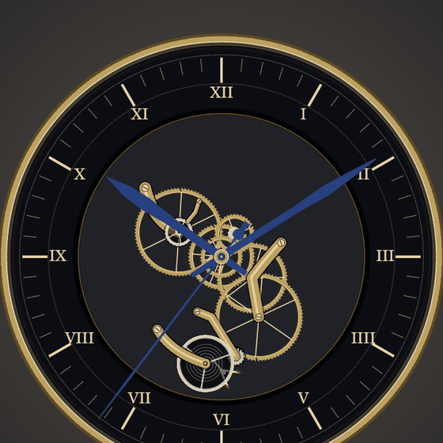
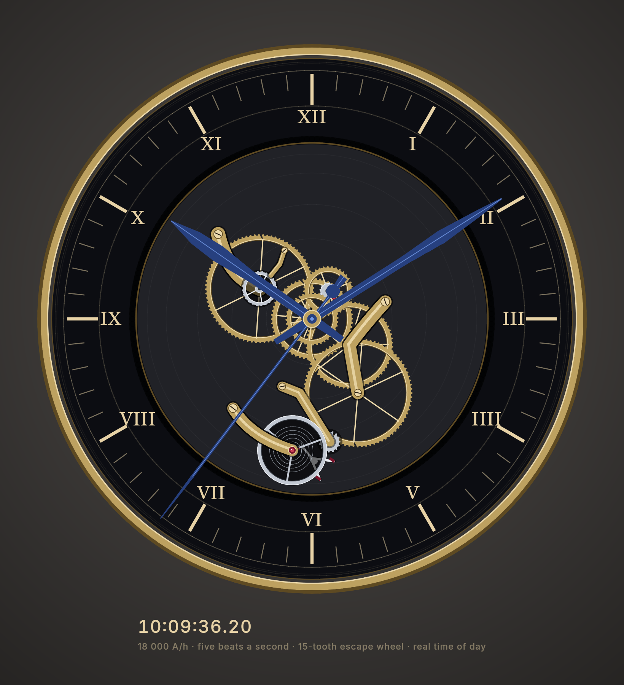

# Mechanical clock

A wall clock in Rust whose hands are not animated. They are *driven*: a going train of gears with
real tooth counts turns a 15-tooth escape wheel once every three seconds, a lever escapement lets it
past one tooth at a time — five beats a second — and the hands hang off the wheels that the
mathematics of those teeth put them on. Between beats the train stands locked; at each beat it comes
forward and rests again. That is why the second hand creeps in five fine steps a second instead of
gliding, and why the escape wheel and balance wheel look busy while the minute hand looks still.

Rendered with [Rune](https://github.com/anomalyco/rune), a GPU UI framework: every wheel, tooth,
bridge, jewel and hand is a vector shape rebuilt each frame from the simulation, not a sprite or a
CSS animation.





## The movement

`cargo run -- --train` prints what the app is actually running (annotated here; the tool prints
just the numbers):

```
arbor    wheel  pinion  seconds per turn
barrel      80       0        28800.000      mainspring drum, 1 turn in 8 h
centre      60      10         3600.000      1 turn an hour - the minute hand
third       64       8          480.000      1 turn in 8 min
fourth      80       8           60.000      1 turn a minute - the seconds hand
escape      15       4            3.000      1 turn in 3 s
cannon      12       0         3600.000      motion work, under the hands
minute      36      12        10800.000
hour        40      10        43200.000      1 turn in 12 h - the hour hand

5 beats a second, 18000 A/h, balance 2.50 Hz

mesh                        teeth  ratio  line
barrel       -> centre        80:10    8.00   30.0deg
centre       -> third         60:8     7.50   35.0deg
third        -> fourth        64:8     8.00   80.0deg
fourth       -> escape        80:4    20.00  120.0deg
cannon       -> minute        12:36    0.33  -60.0deg
minute       -> hour          10:40    0.25  120.0deg
```

Every number is a consequence of the one before it. One turn an hour at the centre wheel, through
60:8, 64:8 and 80:4, leaves the escape wheel turning once every three seconds; with 15 teeth that
is one tooth every 3/15 s — **five beats a second, 18 000 alternations an hour**, the classic
pocket-watch rate. The balance swings at half that, 2.5 Hz.

Nothing here is a fudge factor, and nothing is drawn in two places: `src/movement.rs` owns the
mechanism, `src/draw.rs` only paints what `movement.rs` says.

### The gears really mesh

All wheels share one module (pitch diameter per tooth), so pitch radii add up to the centre
distances between arbors — which is why the teeth interleave instead of overlapping. Each driven
arbor's phase is then solved from its driver's, so along the line of centres a tooth always meets a
gap; `every_mesh_lines_a_tooth_up_with_a_gap` asserts it at five times of day. The wheels counter-
rotate, as meshing wheels must.

### The escapement quantises the clock

The hands do not read the system clock directly. Time is snapped onto the beat grid: the train sits
locked for most of each beat and travels the rest during the impulse, easing out into the banking
(`IMPULSE`, 34% of the beat). Over any whole beat the average is exact, so the clock neither gains
nor loses — `the_beat_quantiser_never_drifts` checks that whole beats stay exactly 0.2 s apart while
the shown time never strays more than one beat from the wall clock.

| where | what moves |
| --- | --- |
| escape wheel | one tooth (24°) per beat, quickly |
| fourth wheel + seconds hand | 1.2° per beat: five steps a second, 300 to a revolution (0.05 s of time each) |
| minute hand | 0.02° per beat, so it looks still and is not |
| centre, third, barrel | the same impulse, geared down from the fourth |
| minute wheel / hour wheel | driven by the motion work, 12:1 |
| balance | a clean 2.5 Hz cosine, its extremes on the beats |
| pallet fork | thrown from one banking to the other across the impulse |

## Drawing

- **Skeleton wheels.** A ring with a hole is not a simple polygon, so each wheel is one polygon
  whose outline runs the toothed rim and then comes back around an inner circle through a hairline
  slit (SVG fill-rule trickery avoided). The hairspring is a 5-turn Archimedean spiral, the pallet
  stones and jewels are ellipses of `#7A132B`.
- **Linear light.** Rune paints in linear light and encodes to sRGB on output, so the palette is
  authored as *linear* values of the colours named in the comments. Feeding it hex numbers directly
  is what makes a near-black dial come out grey.
- **Layout.** The clock is authored in a 1000 × 1000 design space and scaled to the window, so it
  resizes; the chapter ring, numerals and hands all scale with it.
- **Frames.** `poll` runs every frame, rebuilds the movement and the hands, and calls
  `tx.wake_after(Duration::ZERO)` to ask for the next one — returning `true` only says the state
  changed, it does not schedule a frame. The dial furniture is memoised, the movement is not.

## Build

Rune is pre-release, so it is pinned as a git submodule and patched the way its own repo does:

```console
git clone --recursive https://github.com/adhikasp/mechanical-clock
cd mechanical-clock
cargo run --release
```

If you cloned without `--recursive`: `git submodule update --init --depth 1`.

Rune needs its patched copies of `wgpu-hal`, `winit` and `parley_engine` (see `[patch.crates-io]`
in `Cargo.toml`); that is why the submodule is there rather than a bare git dependency. Windows
wants the MSVC toolchain, which is rustup's default.

Press nothing: it reads the local system clock, including DST. The readout under the dial shows the
time the *hands* show, so you can watch it step with the escapement.

## Tooling

```
cargo run --release -- --train                     # print the movement, exit
cargo run --release -- --snap out.png --scene hero # render a still at 10:09:36
cargo run --release -- --scene hero --out frames --frames 60 --fps 30   # dump frames
uv run scripts/make-assets.py                      # regenerate assets/
```

`--scene hero` pins the display to 10:09:36 (the photographer's time) so stills are reproducible
frame for frame; `--at SECONDS` moves that along. `--out` and `--snap` are Rune's headless renderer,
which is how `assets/` is produced — no desktop capture anywhere in the loop.

`scripts/make-assets.py` is a PEP 723 script (Pillow) that renders the still and assembles the GIF.
The GIF is quantised to one 160-colour palette up front; letting Pillow invent a palette per frame
triples the file.

## Verification

- `cargo test` — five tests: the train multiplies out to 5 beats/s (18 000 A/h), the hands run at
  their wheels' rates, the hands read the right time, the beat quantiser never drifts, and every
  mesh lines a tooth up with a gap.
- Headless render, release build: **2.6 ms of CPU per frame** (p50) at 60 fps, 11 000 shape
  instances.
- Live window on Windows 11, 820 × 900 points at 150% scaling (1252 × 1406 px): **59 fps**, about
  18% of one core on a Ryzen 5 5600 / RTX 3060 Ti, measured 2026-11-17 with the frame-rate readout
  the app draws under the dial.

## Notes

- The movement is a plausible wristwatch-scale train, not a copy of any particular calibre. The
  tooth counts are chosen so the ratios work out to 18 000 A/h; the layout of the bridges, the
  motion work and the escapement is arranged to read clearly at this size.
- 18 000 A/h (5 beats/s) is a classic pocket-watch rate, and it is what makes the second hand's
  motion read as a fine, busy creep. For 28 800 A/h (8 beats/s) the fourth-to-escape ratio would
  have to be 32:1 instead of 20:1 — change `fourth.wheel`/`escape.leaves` and `BEAT_HZ` follows,
  because it is asserted from the train rather than written down.
- The `--train` table's "line" column is the direction from one arbor to the next, which the meshing
  solver uses.
- Rune's `--snap`/`--out` are behind its `tooling` feature in release builds; `Cargo.toml` enables
  it.

MIT.
